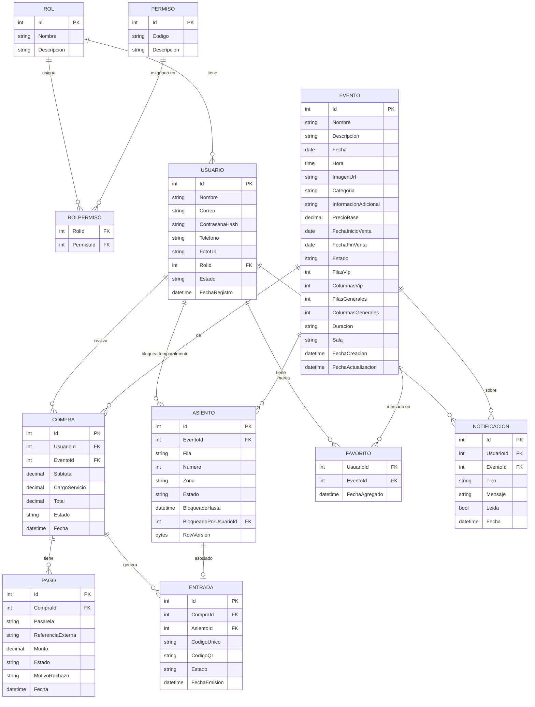

# Backend — Teatro Luminaria

API REST en ASP.NET Core para la gestión y venta de entradas del teatro. Vive en `backend/` dentro del monorepo; el frontend (React + Vite) está en la raíz del repositorio y no se modifica desde aquí.

## Requisitos

- [.NET SDK 10](https://dotnet.microsoft.com/download) (se desarrolló con `10.0.400`; `dotnet --version` para confirmar el instalado).
- SQL Server: Express, LocalDB, o un contenedor Docker.
- Herramienta `dotnet-ef` (si no está: `dotnet tool install --global dotnet-ef`).

## Configuración

1. Copiar la plantilla de configuración:

   ```
   cd backend/TeatroLuminaria.Api
   cp appsettings.Example.json appsettings.Development.json
   ```

2. Editar `appsettings.Development.json` (no se versiona — está en `.gitignore`):
   - `ConnectionStrings:DefaultConnection`: cadena de conexión a tu SQL Server. Ejemplos:
     - LocalDB (Windows): `Server=(localdb)\MSSQLLocalDB;Database=TeatroLuminaria;Trusted_Connection=True;TrustServerCertificate=True`
     - SQL Server Express: `Server=.\SQLEXPRESS;Database=TeatroLuminaria;Trusted_Connection=True;TrustServerCertificate=True`
     - Docker: `Server=localhost,1433;Database=TeatroLuminaria;User Id=sa;Password=<clave>;TrustServerCertificate=True`
   - `Jwt:Clave`: una cadena aleatoria de al menos 32 caracteres (es el secreto para firmar los tokens; no se comparte ni se versiona).

   Para levantar SQL Server con Docker en Mac/Linux/Windows:

   ```
   docker run -e "ACCEPT_EULA=Y" -e "MSSQL_SA_PASSWORD=<ClaveSegura123!>" -p 1433:1433 --name sqlteatro -d mcr.microsoft.com/mssql/server:2022-latest
   ```

## Cómo correr

Backend (desde `backend/TeatroLuminaria.Api/`):

```
dotnet restore
dotnet ef database update
dotnet run
```

- Swagger: `http://localhost:5253/swagger` (o el puerto que indique la consola).
- Al iniciar, si la base está vacía, se cargan automáticamente los datos de prueba (roles, permisos, los 2 usuarios y los 6 eventos — ver sección Seed).

Frontend (desde la **raíz** del repositorio, en otra terminal):

```
npm install
npm run dev
```

Corre en `http://localhost:3000` (puerto fijado en el script `dev` de `package.json`). El backend acepta peticiones CORS desde `http://localhost:3000` y `http://localhost:5173` (puerto por defecto de Vite).

## Credenciales de prueba (seed)

| Correo | Contraseña | Rol |
|---|---|---|
| `admin@luminaria.com` | `Admin123!` | Administrador |
| `cliente@luminaria.com` | `Cliente123!` | Cliente |

## Autenticación en Swagger

1. `POST /api/auth/login` con una de las credenciales de arriba.
2. Copiar el `token` de la respuesta.
3. Botón **Authorize** (arriba a la derecha) → pegar **solo el token**, sin el prefijo `Bearer ` → Authorize.

## Endpoints

| Método | Ruta | Acceso | Notas |
|---|---|---|---|
| GET | `/api/salud` | Público | Comprobación de que la API está viva |
| POST | `/api/auth/registro` | Público | Crea un Cliente. `409` si el correo ya existe, `400` si faltan datos o la contraseña tiene menos de 6 caracteres |
| POST | `/api/auth/login` | Público | Devuelve `{ token, usuario }`. `401` con credenciales inválidas, `403` si la cuenta está inactiva |
| GET | `/api/auth/me` | Autenticado | Datos del usuario del token |
| GET | `/api/usuarios` | Administrador | Nombre, correo, fecha de registro y estado de todos los usuarios |
| GET | `/api/eventos` | Público | Solo eventos `Publicado` (el administrador también ve `Borrador`). Filtros opcionales por query string: `categoria`, `texto` (busca en nombre/descripción), `desde`, `hasta` (fecha del evento). Incluye `estadoVenta` calculado (`EnVenta` / `Proximamente` / `Cerrada`) y disponibilidad (`asientosDisponibles` / `asientosTotales`) |
| GET | `/api/eventos/{id}` | Público | Detalle del evento con el mapa de asientos completo (`id`, fila, número, zona, estado y precio calculado; el `id` es el que usan `/api/compras/reservar` y `/api/compras`). `404` si es `Borrador` y quien pregunta no es administrador |
| POST | `/api/eventos` | Administrador | Crea el evento (queda en `Borrador`) y genera sus asientos según `filasVip/columnasVip/filasGenerales/columnasGenerales` |
| PUT | `/api/eventos/{id}` | Administrador | Edita los datos del evento (no el layout de asientos, para no desincronizarlo de los ya generados) |
| PATCH | `/api/eventos/{id}/estado` | Administrador | Cambia el estado (`Borrador` / `Publicado` / `Cancelado` / `Finalizado`) |
| DELETE | `/api/eventos/{id}` | Administrador | `409` si el evento ya tiene compras; si no, borra el evento y en cascada sus asientos y favoritos |
| POST | `/api/compras/reservar` | Autenticado | Bloquea `asientoIds` (ids numéricos) de un evento por 5 minutos a nombre del usuario. No hay un recurso de "reserva" aparte: el bloqueo vive en el propio asiento (`usuario` + `bloqueadoHasta`). `409` si alguno está vendido o bloqueado por otra persona |
| POST | `/api/compras` | Autenticado | Cobra (pasarela simulada) y confirma la compra de `asientoIds` ya reservados por el mismo usuario. `simularRechazo: true` fuerza un pago rechazado (`402`). `409` si algún asiento no está reservado por este usuario o su bloqueo ya venció (se distingue por el mensaje, no por el código). Al aprobarse, genera una `Entrada` por asiento con su `CodigoQr` (patrón Observer + Builder, ver `DOCUMENTACION_COMPRA.md`) |
| GET | `/api/compras/mias` | Autenticado | Historial de compras del usuario (evento, fecha, totales, estado, cantidad de asientos). `cantidadAsientos` cuenta las entradas emitidas, así que una compra `Rechazada`/`Pendiente` muestra 0 |
| GET | `/api/entradas/mias` | Autenticado | Entradas del usuario (evento, asiento, `codigoUnico`, `codigoQr` en PNG base64), separadas en `proximas`/`pasadas` según la fecha del evento |

Convenciones: errores en JSON `{"mensaje": "..."}`; los enums se serializan como texto (ej. `"Publicado"`, no un número); el JWT expira en 2 horas y lleva el id, correo, rol y permisos del usuario.

## Modelo de datos (ER)



Nota: este es el modelo **completo y definitivo** de la base (13 tablas incluyendo `RolPermiso` y `__EFMigrationsHistory`, 11 tablas de dominio). Esta entrega implementa autenticación, roles, CRUD de eventos, y compra/pago/entradas con QR (`/api/compras/*`, `/api/entradas/*`, ver `DOCUMENTACION_COMPRA.md`); `Favorito` y `Notificacion` ya existen en la base pero sus endpoints los implementan otros compañeros.

## Seed

Al iniciar, si la tabla `Roles` está vacía, se cargan automáticamente:
- Roles `Cliente` y `Administrador`, y los 5 permisos (`eventos.gestionar`, `usuarios.ver`, `empleados.gestionar`, `roles.gestionar`, `metricas.ver`), todos asignados a `Administrador`.
- Los 2 usuarios de prueba de la tabla de arriba.
- Los 6 eventos de `src/datos/seed.js` del frontend, con sus asientos generados y los `asientosOcupados` del seed marcados como `Vendido`.

No se cargan los demás usuarios ni las compras de ejemplo del frontend (`usuariosSeed`/`comprasSeed`): el equipo los crea según lo necesite cada funcionalidad.
